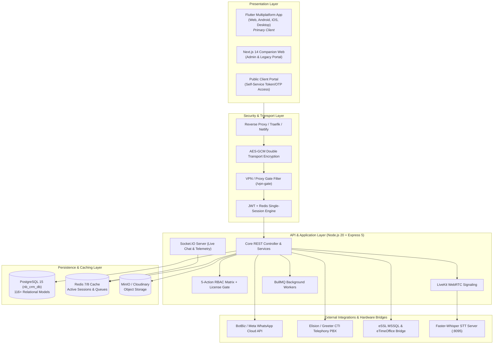
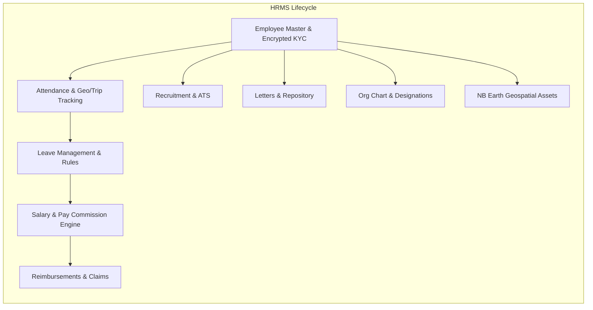
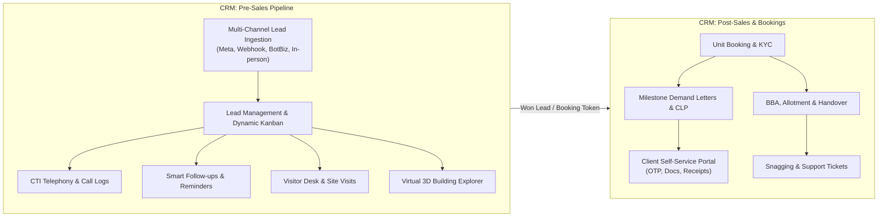
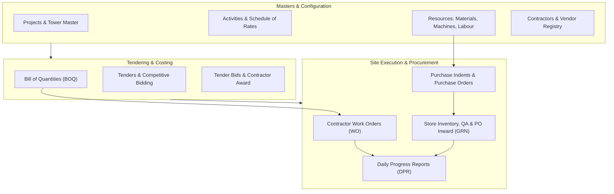
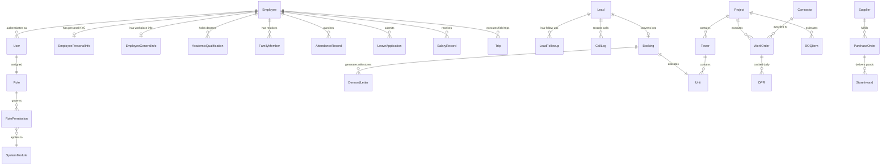

# NB System Architecture & Technical Specification Report
**HRMS · CRM (Pre-Sales & Post-Sales / Multi-Scope) · ERP**

---

## 1. Executive & Architectural Overview

The NB Platform is an enterprise-grade multi-suite system integrating **Human Resource Management (HRMS)**, **Customer Relationship Management (CRM)**, and **Enterprise Resource Planning (ERP)** under a unified multi-tenant architecture. Originally engineered to meet demanding corporate and infrastructure developer standards, the system operates on a single codebase with modular licensing gates, real-time telemetry, and hardware integrations.

---

## 2. Complete Technology Stack

| Layer | Technology | Version | Purpose / Architectural Role |
| :--- | :--- | :--- | :--- |
| **Primary Frontend** | Flutter / Dart | 3.9+ / Dart 3.x | Cross-platform client (Web, Android, iOS, Windows Desktop). Uses BLoC pattern, GoRouter, Dio client. |
| **Companion Web** | Next.js / React | 14.x / React 18 | SSR/SSG administrative and legacy HRMS dashboard with Tailwind CSS. |
| **API Server** | Node.js / Express | Node 20.x / Express 5.x | High-throughput TypeScript API runtime with async handlers and modular routers. |
| **ORM / Data Access** | Prisma ORM | 6.x | Schema-driven type-safe data layer with 116+ relational models. |
| **Primary Database** | PostgreSQL | 15.x | ACID-compliant relational persistence (`nb_crm_db` cluster on port 5434). |
| **In-Memory Store** | Redis | 7 / 8 | Session lifecycle enforcement (single concurrent session), distributed caching, BullMQ. |
| **Realtime WebSockets** | Socket.IO | 4.x | Real-time presence, omnichannel chat, notifications, GPS location streaming. |
| **Video & Audio** | LiveKit WebRTC | Latest | Scalable WebRTC conferencing, screen sharing, and interactive rooms. |
| **Speech-to-Text** | Faster-Whisper | Python 3.10 (:8095) | Self-hosted on-premise transcription server generating automated captions for calls. |
| **Object Storage** | Cloudinary & MinIO | Latest (S3 compatible) | Storage for documents, photos, signatures, audio call recordings, BOQ attachments. |
| **Hardware Sync** | Tedious MSSQL Client | 18.x | Native direct connector reading biometric logs from eSSL clocks and eTimeOffice. |
| **Telephony PBX** | Elision / Greeter CTI | REST Webhooks | Call dispatch, webhook event ingestion, and call recording audio proxy. |

---

## 3. Module 1: HRMS (Human Resource Management System)

The HRMS suite covers the end-to-end employee lifecycle, from recruitment and biometric tracking to payroll processing and career progression.

### 3.1 Workforce Directory & Profile Master
* **Core Identity:** Centralized `Employee` model with sequential identification numbers, mapped to authentication credentials.
* **Encrypted KYC (Field-Level AES-256):** Indian statutory identifiers (**Aadhaar** and **Permanent Account Number - PAN**) are encrypted at rest using AES-256-CBC. Audit logging monitors every single view or update event.
* **Comprehensive Multi-Tab Profiles:**
  * **General Information:** Department, designation, date of joining, official email, reporting hierarchy.
  * **Personal & Physical Details:** Date of birth, gender, marital status, blood group, emergency contact matrix.
  * **Address Master:** Dual record keeping for permanent and local residential addresses.
  * **Family Tree:** Lineage records (parents, spouse, children) with dependent tagging and soft-deletion capability.
  * **Academic Qualifications:** Complete educational dossier from Secondary School (SSC) to Doctorate (PhD) with verified document uploads.
  * **Experience Record:** Past employers, designations, CTC, tenure, and relieving certificates.
* **Media Assets:** Verified cloud storage for employee photographs, digital signatures, Aadhaar cards, PAN cards, marksheets, and degree certificates.

### 3.2 Attendance, Biometric & Field Tracking
* **Multi-Modal Punching:**
  * **Geofenced Web & Mobile Punch:** Geolocation verification checking user coordinates against configured site/office boundary radiuses.
  * **Direct eSSL Hardware Bridge:** Direct scheduled integration via MSSQL reading biometric attendance transaction logs from local eSSL clocks.
  * **eTimeOffice Cloud Integration:** Cloud API sync for distributed branch offices.
* **Open Trip GPS Tracking:**
  * Automatically detects when an employee punches in and exits the office geofence (>30m threshold).
  * Continuously logs GPS breadcrumbs to the database with speed, accuracy, and timestamps.
  * Account locking feature: prevents logging out or device-hopping while a field trip is open.
  * Live map pin with dynamic 120-second expiration and full route playback in Admin Tracking Hub.
* **Attendance Policy & Rules:** Flexible shift timings, late-in and early-out grace periods, half-day deduction rules, and self-service attendance regularization requests.

### 3.3 Leave Management Engine
* **Policy Configuration:** Customizable leave quotas including Casual Leave (CL), Sick Leave (SL), Earned/Privilege Leave (EL), Maternity, Paternity, and Compensatory Offs.
* **Multi-Tier Hierarchical Approval Workflow:** Multi-stage sequential approvals (e.g., First Reporting Officer $\rightarrow$ Head of Department [HOD] $\rightarrow$ Head of Institution [HOI] $\rightarrow$ HR).
* **Automated Leave Without Pay (LWP):** Automatic calculation of unpaid leaves based on unregularized absences, directly feeding the monthly salary cut calculations.
* **Accrual & Balance Ledger:** Real-time balance calculations, monthly accrual additions, and year-end carryover or encashment.

### 3.4 Payroll & Dynamic Salary Engine
* **Flexible Salary Structures:** Custom earning components (Basic, HRA, DA, Special Allowance, Conveyance) and deductions (PF, ESI, Professional Tax, TDS).
* **Rule Calculation Types:**
  * `FIXED`: Static currency values.
  * `PERCENTAGE`: Calculated as a dynamic percentage of another column (e.g., PF = 12% of Basic).
  * `CONDITIONAL`: Logical evaluations (e.g., IF Gross > 15,000 THEN PT = 200 ELSE PT = 0).
* **Pay Commission Frameworks:** Built-in support for 6th and 7th Central Pay Commission standards as well as corporate payroll modes.
* **Payable Days Calculation Modes:** Support for corporate standard 26/27 working days or statutory 30/31 calendar days.
* **Disbursement & Payslips:** Generation of formatted PDF payslips, bank disbursement text/excel files, and variance analysis reports.

### 3.5 Reimbursements & Expense Claims
* **Category Breakdown:** Travel, lodging, meals, fuel, client entertainment, and medical allowances.
* **Approval Chain & Digital Evidence:** Mandatory invoice attachment upload, manager review, finance disbursement authorization, and status auditing.

### 3.6 Recruitment & ATS (Applicant Tracking System)
* **Job Requisition Management:** Requisition creation, vacancy headcounts, CTC budgets, and department allocations.
* **Candidate Sourcing & Funnel:** Visual candidate pipeline (Applied $\rightarrow$ Screened $\rightarrow$ Round 1 Interview $\rightarrow$ Technical Round $\rightarrow$ HR Round $\rightarrow$ Offered $\rightarrow$ Hired).
* **Interview Scheduling & Scorecards:** Calendar integration, evaluator scorecards, feedback collection, and automatic candidate email/WhatsApp notifications.

### 3.7 Official Letters & Document Generation
* **Templatized Document Automation:** Dynamic generation of Offer Letters, Letters of Appointment, Appraisal & Increment Letters, Confirmation Letters, and Relieving/Experience Certificates.
* **Digital Signatures & Watermarks:** Automated variable injection (CTC, designation, joining date, reporting manager) with authorized digital signatures and watermarking.

### 3.8 Organizational Hierarchy & Reporting Trees
* Interactive, visual tree view showing the corporate reporting chain from Board of Directors/MD down to individual associates.

### 3.9 NB Earth (Geospatial Real Estate & Land Master)
* **3D Visual Shader Globe:** Custom GLSL fragment shader globe (`shaders/earth_sphere.frag`) rendered natively in Flutter, alongside 2D OpenStreetMap/Satellite views.
* **Property Inventory Mapping:** Geospatial property pins, polygon boundaries for land parcels, historical valuation charts, and property media dossiers.

---

## 4. Module 2: CRM (Both Pre-Sales & Post-Sales / Multi-Scope)

The CRM system is architected to handle both **Pre-Sales pipeline acceleration** and **Post-Sales customer lifecycle & booking management**. Additionally, the architecture supports dual operational scopes: **`NB_DEVELOPER`** (Real Estate & Infrastructure) and **`NB_FINSERVE`** (Financial Products & Mortgages).

### 4.1 Pre-Sales CRM Capabilities
1. **Omnichannel Ingestion Engine:**
   * **Social & Digital Ad Webhooks:** Instant programmatic capture of leads from Meta (Facebook/Instagram Lead Ads), Google Ads, and IndiaMART.
   * **WhatsApp Cloud API / BotBiz:** Ingestion of inbound WhatsApp chats directly into the lead inbox with automatic lead creation.
   * **Public Landing Forms:** Cross-origin verified landing page endpoints with automated UTM tracking.
2. **Dynamic Header & Kanban Pipeline:**
   * Fully configurable sales stages (e.g., *New*, *Contacted*, *Site Visit Scheduled*, *Negotiation*, *Token Received*, *Lost*).
   * User-defined dynamic custom fields/headers with real-time column visibility toggling, drag-and-drop reordering, and column merging.
3. **Smart Telephony Integration (CTI):**
   * Two-way webhooks connecting to **Elision / Greeter CTI** telephony systems.
   * Automatic call duration logging, telecaller attribution, and direct in-app streaming of audio recordings via a secure audio proxy endpoint.
4. **Follow-Up Automation & Smart Scheduler:**
   * Automated reminder alerts for overdue, due-today, and scheduled follow-ups.
   * Activity timeline logging every call, WhatsApp message, email, and meeting chronologically.
5. **Visitor Desk & Reception Walk-In Logging:**
   * Front-desk tablet interface for registering walk-in visitors at project site offices.
   * Automatic round-robin or manual assignment of sales representatives with visitor gate-pass generation.
6. **Virtual 3D Building & Interactive Inventory Navigator:**
   * Interactive Flutter visualizer of real estate projects, building towers, floor plans, and units.
   * Real-time color-coded inventory statuses (*Available*, *Booked*, *Blocked/On Hold*).
   * Instant quotation generator computing base price, floor rise charges, PLC, car parking, and statutory taxes.
7. **Automated WhatsApp Campaigns:**
   * Automated brochure PDF delivery to prospects upon lead capture or visitor check-in.
   * Template-driven WhatsApp messaging for site visit confirmations, reminders, and festival greetings.
8. **CRM Recycle Bin (Data Recovery):**
   * Soft-delete architecture preventing accidental loss of client contacts.
   * Audit trail of deletions with single-click restoration capabilities.

### 4.2 Post-Sales CRM Capabilities
1. **Booking & Inventory Allocation:**
   * Converts won pre-sales leads into confirmed unit bookings.
   * Captures primary applicant details, joint applicants, nominee declarations, payment terms, and booking token receipts.
2. **Payment Schedules & Construction-Linked Plans (CLP):**
   * Configurable milestone payment plans (e.g., *10% on Booking*, *15% on Foundation*, *10% on Plinth*, *10% per Slab*, *Balance on Possession*).
   * Automatic milestone trigger alerts: when ERP Daily Progress Reports mark a slab complete, the CRM automatically generates customer demand letters.
   * Automated overdue interest calculation on delayed customer payments.
3. **Public Client Self-Service Portal:**
   * Secure, token-based public web portal for property buyers (`/api/crm/client-portal/:token`).
   * Two-Factor Authentication via SMS/WhatsApp OTP.
   * **Self-Service KYC:** Buyers can upload scanned Aadhaar cards, PAN cards, photographs, and power-of-attorney documents directly.
   * **Payment History & Receipts:** Direct access to downloadable payment receipts, outstanding ledger balances, and payment milestones.
   * **Real-Time Construction Progress:** Buyers view photographic and video construction updates pulled directly from site DPRs.
4. **Legal Documentation & Agreement Tracking:**
   * Tracks preparation, stamp duty payment, and execution of Allotment Letters, Builder-Buyer Agreements (BBA), and Tripartite Bank Agreements.
5. **Handover, Snagging & Customer Support:**
   * Snagging inspection list management prior to key handover.
   * Sign-off workflows for keys, parking slot allotment, and possession certificates.
   * Post-possession helpdesk for society maintenance tickets, civil defect reports, and warranty tracking.

### 4.3 Multi-Scope Architecture: Real Estate vs. Financial Services
* **Real Estate (`NB_DEVELOPER`):** Optimized for builders, developers, and brokers handling properties, towers, units, site visits, and construction milestones.
* **Financial Services (`NB_FINSERVE`):** Tailored for housing finance, loan syndication, and financial advisory services. Handles loan applications, CIBIL score tracking, banking eligibility calculations, sanction letters, and loan disbursement tracking.

---

## 5. Module 3: ERP (Enterprise Resource Planning for Construction & Operations)

The ERP suite provides comprehensive project governance for real estate and construction operations, covering everything from architectural hierarchies to material indents and contractor billing.

### 5.1 Project & Tower Structural Master
* **Hierarchical Infrastructure Breakdown:** `Project` $\rightarrow$ `Phase` $\rightarrow$ `Tower / Block` $\rightarrow$ `Floor` $\rightarrow$ `Unit / Flat / Office`.
* **Component Modeling:** Tracks built-up area, carpet area (RERA), super built-up area, configuration (1BHK, 2BHK, 3BHK, Penthouse, Commercial), facing, and terrace specifications.
* **Pricing Formulas & Rate Setup:** Defines base square-foot rates, Preferred Location Charges (PLC), floor-rise premiums, clubhouse charges, electricity/water infrastructure fees, and legal documentation charges.

### 5.2 Bill of Quantities (BOQ) & Cost Estimation
* **Detailed Work Item Classification:** Itemized breakdown of civil, electrical, plumbing, finishing, and structural works.
* **Quantity & Rate Analysis:** Scheduled quantities, unit of measurement (UOM), rate analysis, labor constants, and material consumption coefficients.
* **Variation Orders & Revisions:** Tracks design variations, quantity overruns, and authorized budget revisions.

### 5.3 Daily Progress Reports (DPR)
* **Real-time Daily Site Logging:** On-site engineers capture comprehensive daily operational logs:
  * **Activities Executed:** Specific work items completed per tower and floor (e.g., *Tower A - 5th Floor Slab Concreting*).
  * **Labor Attendance & Headcount:** On-site contractor labor breakdown categorized by skilled masons, carpenters, bar benders, and unskilled labor.
  * **Machinery & Equipment Utilization:** Runtime hours, idle time, and breakdown logs for tower cranes, concrete pumps, batching plants, and JCB excavators.
  * **Material Consumption:** Actual quantities of cement, ready-mix concrete (RMC), TMT steel bars, and bricks consumed on that day.
  * **Weather & Impediments:** Rain delays, power outages, material shortages, or safety incidents.
  * **Photographic Evidence:** Daily geo-tagged site photographs uploaded directly from mobile devices.

### 5.4 Contractor Work Orders (WO) & Billing
* **Work Order Generation:** Issuance of binding digital work orders to contractors linked directly to the approved BOQ and item rates.
* **Measurement Book (MB) & Milestone Billing:** Recording physical measurements executed on site, applying retention money deductions (typically 5%), TDS deductions, and advance payment amortizations.
* **Payment Certification:** Issuance of Interim Payment Certificates (IPC) and Final Contractor Settlement certificates.

### 5.5 Store, Inventory & Procurement
* **Resource Cataloging:** Master registry of thousands of construction materials, heavy machinery, power tools, safety gear, and testing instruments.
* **Purchase Management Workflow:** Site Indent (Material Requisition) $\rightarrow$ Request for Quotation (RFQ) $\rightarrow$ Vendor Quotation Comparison Matrix $\rightarrow$ Purchase Order (PO) approval.
* **Store PO Inward & Quality Inspection (GRN):**
  * Receiving of consignments against PO with delivery challan verification.
  * Quality Assurance (QA) pass/fail logging (e.g., concrete cube test results, steel tensile strength certificates).
  * Automated Goods Receipt Note (GRN) generation and real-time inventory ledger updates.
* **Store Issuance & Stock Transfers:** Issue slips for materials allocated to specific towers or contractor work orders, preventing on-site pilferage and unaccounted usage.

### 5.6 Tenders & Competitive Subcontracting
* **Tender Notice Publication:** Creation of competitive tenders with scope documents, BOQ estimates, earnest money deposit (EMD) requirements, and submission deadlines.
* **Tender Applications & Bidding:** Contractor submission of technical credentials and itemized financial bids.
* **Comparative Evaluation Matrix:** Side-by-side automated comparison of financial bids ($L1, L2, L3$), technical qualifications, and final contract award.

### 5.7 Vendor & Contractor Compliance Master
* Comprehensive profiles for sub-contractors and suppliers including GSTIN, PAN, PF/ESIC registrations, bank account details, credit terms, past project references, and internal performance ratings.

---

## 6. Cross-Cutting Platform Infrastructure

### 6.1 Authentication & Session Security
* **Double-Layered Encryption:**
  * **At-Rest Encryption:** AES-256-CBC for sensitive employee data (Aadhaar, PAN).
  * **In-Transit Encryption:** AES-GCM encrypted payload envelopes between Flutter clients and Express API (`TRANSPORT_SECRET`), protecting against man-in-the-middle inspection.
* **Redis Single-Session Enforcement:** Each user is restricted to one live session in Redis (`session:{userId}`). Attempting to log in on a second device terminates the first session immediately.
* **Trip-Lock Protection:** If an employee has an active field trip (`trips.end_time` is null), the system blocks account sign-out and session transfers until they punch out or return to the geofence.

### 6.2 Granular RBAC Matrix (5-Action Permission Model)
Every role permissions record provides five discrete action flags per system module:
$$\text{Permission} = (\text{Module}, \text{canRead}, \text{canWrite}, \text{canApprove}, \text{canDelete}, \text{canExport})$$
Modifying any role’s permissions automatically purges all live Redis sessions for users with that role, requiring an immediate fresh authentication to apply updated access tokens.

### 6.3 Real-Time Collaboration Suite
* **Omnichannel Chat:** Socket.IO powered messaging supporting one-on-one direct messages, project group channels, read receipts, and file attachments stored on MinIO.
* **Video Conferencing & Meetings:** LiveKit WebRTC server supporting low-latency multi-party video calling, screen sharing, and automated real-time speech captions powered by Faster-Whisper.
* **Task Hub:** Task assignment board with deadlines, priorities, status tracking, and dependency linking.

---

## 7. Comprehensive Database Data Model (Prisma Highlights)

The PostgreSQL database (`nb_crm_db`) encapsulates over 116 relational models managed by Prisma ORM:

---

## 8. Deployment Architecture & Operations

| Component | Production Target | Deployment Mode | Port / Routing |
| :--- | :--- | :--- | :--- |
| **API Server** | Hostinger VPS / Render | Docker Compose / Systemd | `https://crm.nbdeveloper.co.in/api` (:4000) |
| **Flutter Web** | Netlify / Hostinger Web | Static WASM/HTML5 Distribution | `https://crm.nbdeveloper.co.in` |
| **PostgreSQL** | Linux VPS Hostinger | Dedicated Docker Container | Internal port 5434 |
| **Redis** | Linux VPS Hostinger | Dedicated Docker Container | Internal port 6380 |
| **LiveKit Meet** | Linux VPS Hostinger | Docker Container with UDP range | Port 7880 + WebRTC UDP ports |
| **Whisper STT** | Dedicated GPU/CPU instance | Python Faster-Whisper Service | Port 8095 |
| **Traefik Proxy** | Linux VPS Hostinger | Automated Let's Encrypt TLS | Ports 80, 443 |

---

## 9. Summary & Architectural Merits

1. **True Unified Enterprise Core:** Combines HRMS personnel management, CRM client relationship tracking, and ERP site operations into a single cohesive data model, eliminating data silos between site engineers, sales agents, and HR administrators.
2. **Field-Engineered for Real-World Conditions:** Hardened against intermittent connectivity with client-side queuing, GPS accuracy thresholds, trip locks, and automated offline-first mobile considerations.
3. **Enterprise Defense in Depth:** Combines AES-256 database field encryption, AES-GCM transport encryption, single active Redis sessions, and granular 5-action RBAC for strict governance.
