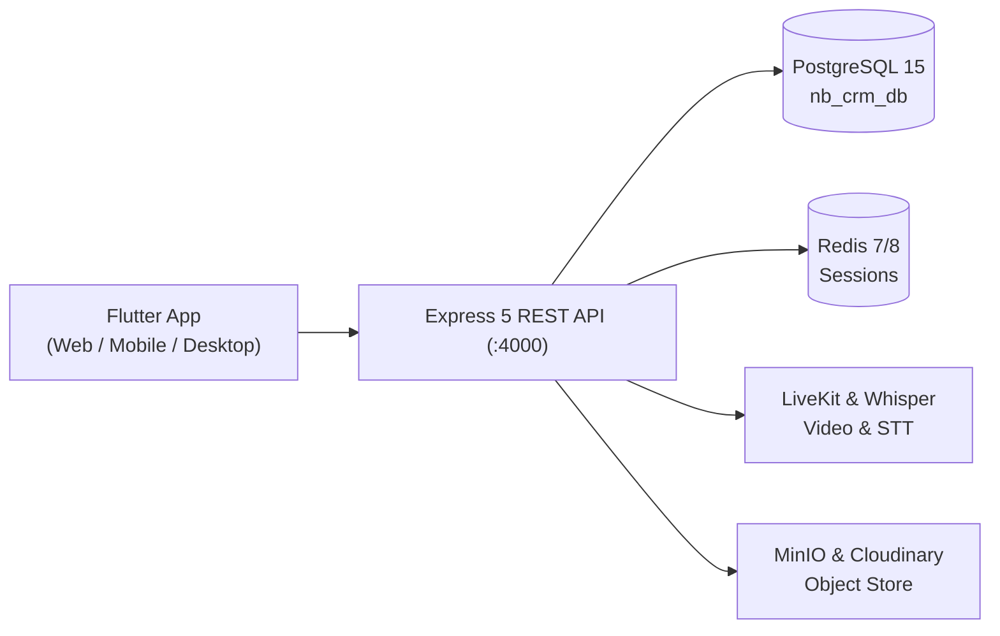

# NB Platform — Executive Summary & Feature Quick Reference
**HRMS · CRM (Pre-Sales & Post-Sales) · ERP**

---

## 1. System at a Glance

The NB Platform is a unified, multi-tenant enterprise system delivering three interconnected suites on a single database and API core:

1. **HRMS**: Full workforce lifecycle, geofenced & biometric attendance, open-trip GPS tracking, multi-tier leaves, dynamic formula payroll, and ATS recruitment.
2. **CRM (Pre-Sales & Post-Sales)**: Omnichannel lead ingestion (Meta, WhatsApp, Webhooks), dynamic Kanban pipelines, telephony CTI with call recording playback, 3D interactive virtual building navigator, visitor desk, automated booking demand letters, and a secure public client self-service portal.
3. **ERP (Real Estate & Construction)**: Hierarchical project/tower structures, itemized BOQ, daily progress reports (DPR), store inventory with QA inspection (GRN), purchase workflows, contractor work orders, and competitive tender bidding.



---

## 2. Technology Stack Summary

| Domain | Technology | Key Details |
| :--- | :--- | :--- |
| **Client Frontend** | **Flutter 3.9+** (Dart) | Single codebase for Web, Android, iOS, Windows Desktop. Uses BLoC & GoRouter. |
| **Companion Web** | **Next.js 14** (React, Tailwind) | Administrative portal & legacy HRMS interface. |
| **Backend API** | **Node.js 20 + Express 5** (TypeScript) | High-performance modular architecture with strict Zod validation. |
| **Database** | **PostgreSQL 15** (`nb_crm_db`) | 116+ relational models managed with Prisma ORM 6. |
| **Session & Cache** | **Redis 7/8** | Enforces single concurrent login per user; session revocation. |
| **Transport Security** | **AES-GCM Double Encryption** | Encrypted payload envelope between Flutter and Express API. |
| **Data Protection** | **AES-256-CBC at Rest** | Sensitive fields (Aadhaar, PAN) encrypted with audit logging. |
| **Realtime & Media** | **Socket.IO + LiveKit WebRTC** | Live chat, GPS stream, multi-party video conferencing, Whisper captions. |
| **Hardware Links** | **MSSQL & Webhooks** | Direct eSSL biometric attendance sync; Elision/Greeter CTI PBX integration. |

---

## 3. High-Level Feature Breakdown by Suite

### 3.1 HRMS (Human Resource Management)
* **Workforce Master:** Comprehensive profiles (General, Personal, Address, Family, Academic Qualifications, Past Experience) with document uploads.
* **Biometric & Geo Attendance:** Geofenced punch-in/out via mobile/web, direct MSSQL sync for eSSL fingerprint clocks, eTimeOffice cloud sync, shift management, and punch regularization.
* **Open-Trip Live GPS Tracking:** Automatic trip initiation upon leaving office geofences (>30m), real-time breadcrumbs, live map pins (120s TTL), route playback, and session lock during active trips.
* **Leave Management:** Custom leave quotas (CL, SL, EL, Maternity, LWP), multi-level approval workflows (HOD $\rightarrow$ HOI $\rightarrow$ HR), automated balance ledger, and payroll deduction sync.
* **Dynamic Payroll Engine:** Configurable earnings & deductions using Fixed, Percentage, or Conditional rules; 6th/7th Pay Commission support; 26/27 working day vs 30/31 calendar day calculations; automatic PDF payslips.
* **Reimbursements:** Multi-category expense claims with digital receipt attachments and multi-stage approval.
* **Recruitment & ATS:** Job openings, visual applicant pipeline stages, interview scheduling, scorecards, and automated candidate communications.
* **Letters & Document Generator:** Templatized auto-generation of Offer Letters, Appointment Letters, Appraisal Letters, and Relieving Certificates with digital signatures.
* **Org Structure:** Interactive visual organizational chart and reporting hierarchy tree.
* **NB Earth:** Native 3D GLSL shader globe and 2D satellite maps for geospatial land and property asset tracking.

### 3.2 CRM (Both Pre-Sales & Post-Sales / Multi-Scope)
* **Dual Business Scopes:** Supports both **`NB_DEVELOPER`** (Real Estate & Infrastructure) and **`NB_FINSERVE`** (Loans, Mortgages & Financial Services) via dynamic tenant header scoping.
* **Omnichannel Pre-Sales Ingestion:** Instant lead capture from Meta (Facebook/Instagram Lead Ads), Google Ads, IndiaMART, custom landing pages, and WhatsApp (BotBiz).
* **Dynamic Pipeline & Headers:** Configurable Kanban stages, custom drag-and-drop column headers, column visibility toggles, and column merging.
* **CTI Telephony:** Bi-directional webhooks with Elision / Greeter PBX, telecaller assignment, call logs, and in-app audio recording playback.
* **Visitor Desk:** Front-desk reception logging for project walk-in visitors with automated sales rep allocation.
* **Virtual 3D Building Navigator:** Interactive floor and unit visualizer displaying real-time inventory statuses (*Available*, *Booked*, *Blocked*) and instant price quotations.
* **Automated WhatsApp Marketing:** Pre-approved Meta templates, automated brochure PDF delivery, and appointment reminders.
* **Recycle Bin:** Soft-deletion safeguards with audit trails and instant restore.
* **Post-Sales & Bookings:** Unit allocation, booking token receipts, joint applicant management, and nominee records.
* **Payment Milestones & Demand Letters:** Construction-Linked Payment (CLP) plans, automatic demand letters triggered by site completion, and overdue interest calculations.
* **Public Client Self-Service Portal:** Token and OTP protected buyer portal for uploading KYC documents, viewing payment ledgers, downloading receipts, and checking live construction progress.
* **Handover & Support:** Snagging lists, key handover sign-offs, possession documentation, and post-sales customer service tickets.

### 3.3 ERP (Real Estate & Construction Operations)
* **Project & Site Hierarchy:** Multi-level master structure: `Project` $\rightarrow$ `Phase` $\rightarrow$ `Tower` $\rightarrow$ `Floor` $\rightarrow$ `Unit`.
* **Pricing & Payment Terms:** Base rates, floor-rise formulas, Preferred Location Charges (PLC), club charges, and customized payment milestone schedules.
* **Bill of Quantities (BOQ):** Itemized civil, electrical, and finishing work schedules with unit rates, specifications, and variation tracking.
* **Daily Progress Reports (DPR):** Daily on-site tracking of completed activities, skilled/unskilled labor counts, equipment runtime, material consumption, weather, and geo-tagged photos.
* **Store & Inventory (GRN):** Material and equipment registry, delivery challan verification, Quality Assurance (QA) pass/fail tests, automated Goods Receipt Notes (GRN), and stock issue slips.
* **Purchase Management:** Site material requisitions (Indents), RFQs, vendor quotation comparative analysis, and Purchase Order (PO) approvals.
* **Contractor Work Orders (WO):** Formal contract generation, milestone-based Measurement Book (MB) billing, retention money holdbacks, and Interim Payment Certificates (IPC).
* **Tenders & Bidding:** Competitive tender publishing, contractor bid submissions, commercial evaluation matrices, and contract awarding.
* **Vendor & Contractor Registry:** Contractor KYC, GSTIN/PAN compliance, labor compliance certificates, past performance ratings, and payment ledgers.

### 3.4 Platform, Security & Collaboration
* **Single Concurrent Session:** Strict Redis session locking prevents multi-device logins and prevents unauthorized sharing of accounts.
* **Granular 5-Action RBAC:** Role-based access control with discrete flags: `canRead`, `canWrite`, `canApprove`, `canDelete`, `canExport` per module.
* **Multi-Tenant Licensing:** Tenant-level feature gating for `HRMS`, `CRM`, and `ERP` suites.
* **Real-Time Collaboration:** Group channels and direct messaging (Socket.IO), multi-party video conferencing (LiveKit WebRTC), AI live transcription (Faster-Whisper), and team task management.

---

## 4. Quick Feature Checklist

| Feature Category | Capability | HRMS | CRM | ERP | Platform |
| :--- | :--- | :---: | :---: | :---: | :---: |
| **Identity & Access** | Encrypted KYC, 5-Action RBAC, Single Session | ✅ | ✅ | ✅ | ✅ |
| **Tracking & Field** | Geofence Punching, Open Trips, GPS Trail | ✅ | — | — | ✅ |
| **Workforce** | Profiles, Leaves, Dynamic Payroll, ATS, Letters | ✅ | — | — | — |
| **Lead Generation** | Meta/Google Ads, WhatsApp Ingestion, Webhooks | — | ✅ | — | — |
| **Sales Engagement** | CTI Telephony, Audio Playback, WhatsApp Bot | — | ✅ | — | — |
| **Visual Inventory** | 3D Virtual Building, Color-coded Units, NB Earth | ✅ | ✅ | — | — |
| **Post-Sales** | Bookings, Demand Letters, Client Portal (OTP) | — | ✅ | — | — |
| **Costing & Specs** | Structural Hierarchy, Pricing Formulas, BOQ | — | — | ✅ | — |
| **Site Operations** | DPR, Labor Attendance, Machine Logs, Geo-photos | — | — | ✅ | — |
| **Supply Chain** | Store Inventory, QA Test, PO Inward (GRN), Indents | — | — | ✅ | — |
| **Contractors** | Work Orders, Measurement Book, Bidding/Tenders | — | — | ✅ | — |
| **Collaboration** | Chat, Video Meetings, Whisper STT, Tasks | — | — | — | ✅ |

---

## 5. Deployment & Quick Start Commands

```bash
# 1. Start Infrastructure (Postgres 5434, Redis 6380, Hasura 8080)
docker compose up -d postgres redis

# 2. Run Database Migrations & Seed
cd backend
npm install
npx prisma db push --skip-generate
npx prisma db seed

# 3. Start API Server (:4000)
npm run dev

# 4. Start Flutter Multiplatform Client
cd ../nb_crm_flutter
flutter pub get
flutter run -d chrome
```
